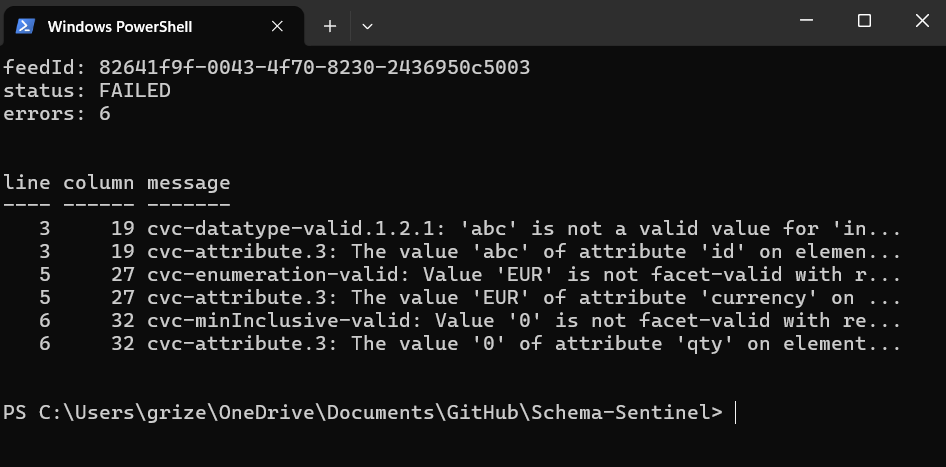
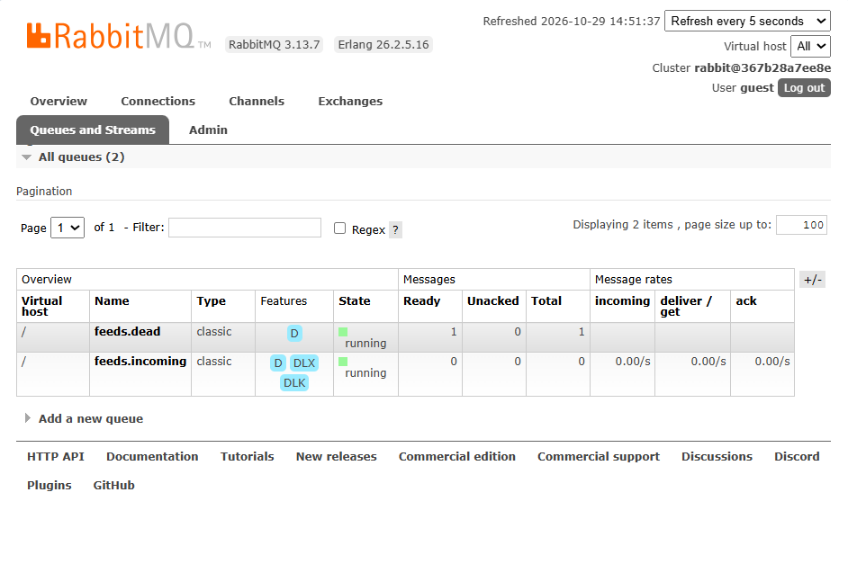

# Schema Sentinel


A Spring Boot gateway that validates incoming XML feeds against versioned XSD schemas, reports **every** error with line and column numbers, and converts valid feeds to JSON. Includes an optional async mode using RabbitMQ with a dead-letter queue and replay.

## The problem
Partners and legacy systems send XML that is often wrong: a missing field, a bad number, an invalid currency. Bad data that reaches downstream systems causes failed jobs and bugs. This service checks feeds at the front door and tells the sender exactly what to fix, all in one pass.

## Features
- Validates XML against **versioned XSDs** (`schemas/v1/`; add `v2/` with no code changes)
- Returns **all** errors at once, with line and column numbers
- Converts valid feeds to clean JSON
- **XXE protection** (DOCTYPE blocked, external entities disabled), covered by a test
- **Async mode:** RabbitMQ worker, dead-letter queue for bad feeds, and a replay endpoint
- JUnit 5 and MockMvc tests, Dockerfile, GitHub Actions CI

## Tech stack
Java 21, Spring Boot 3.3, Maven, RabbitMQ, JUnit 5, Docker, GitHub Actions

## Quick start
Requires JDK 21 and Maven.

```bash
git clone https://github.com/PratigMgr/schema-sentinel.git
cd schema-sentinel
mvn verify            # runs the tests (no Docker or RabbitMQ needed)
mvn spring-boot:run   # starts on http://localhost:8080
```

## Demo

**Valid feed** (`samples/valid.xml`) is converted to JSON:


**Invalid feed** (`samples/invalid.xml`) returns HTTP 422 with every problem and its line number:


Try it yourself:
```bash
curl -X POST http://localhost:8080/api/v1/feeds -H "Content-Type: application/xml" --data-binary @samples/valid.xml
curl -X POST http://localhost:8080/api/v1/feeds -H "Content-Type: application/xml" --data-binary @samples/invalid.xml
```
On Windows PowerShell, use `curl.exe` instead of `curl`.

## API
| Method | Path | Result |
|---|---|---|
| POST | `/api/{version}/feeds` | 200 + JSON, or 422 + error list |
| POST | `/api/{version}/feeds/validate` | 200 if valid, 422 + error list otherwise |
| POST | `/api/{version}/feeds/async` | 202 + `feedId`; validated by a background worker |
| GET | `/api/feeds/{feedId}` | status: QUEUED, PROCESSED (with orders) or FAILED (with errors) |
| POST | `/api/admin/dlq/replay[?version=v2]` | moves dead-lettered feeds back to the main queue |
| GET | `/actuator/health` | health check |

Unknown schema versions return 404.

## Async mode (optional, needs Docker)
```bash
docker compose up -d rabbitmq   # management UI: http://localhost:15672 (guest / guest)
mvn spring-boot:run
```
```
client -> POST /feeds/async -> [feeds.incoming] -> worker validates + converts
                                     |  (invalid feed rejected)
                                     v
                               [feeds.dlx] -> [feeds.dead]  --replay endpoint--> back to feeds.incoming
```
Submit `samples/invalid.xml` to `/api/v1/feeds/async`, check `GET /api/feeds/{feedId}` for the FAILED status, and see the parked message in the `feeds.dead` queue in the RabbitMQ UI.

**Demo:** an invalid feed is submitted to `/api/v1/feeds/async`. The worker rejects it, and `GET /api/feeds/{feedId}` reports `FAILED` with every error and line number:



RabbitMQ shows the rejected feed parked in `feeds.dead`, while `feeds.incoming` is empty:



## Project structure
```
src/main/java/dev/sentinel/
  api/          REST controllers and error handling
  validation/   schema loading and XSD validation
  transform/    XML to Java objects (serialized to JSON)
  async/        RabbitMQ config, worker, status store
src/main/resources/schemas/   versioned XSDs
src/test/                     unit and integration tests
samples/                      example feeds
docs/                         demo screenshots (sync and async)
```

## Design decisions
- **Collect all errors, not just the first.** A custom `ErrorHandler` gathers every violation, so the sender fixes the feed in one pass.
- **Versioned schemas on the classpath.** A new version is a new folder, and schemas are cached after first load.
- **XXE hardening.** DOCTYPE is disabled and external DTD/schema access is blocked, with a test.
- **Dead-letter queue instead of retries for bad data.** An invalid feed will never become valid by retrying, so it is rejected once and parked for a human to inspect.
- **Replay can target another schema version.** After deploying `schemas/v2/`, replay with `?version=v2` to re-process parked feeds without asking partners to resend.
- **Business logic is separate from messaging.** `FeedProcessor` has no RabbitMQ code, so it is unit-tested without a broker.
- **DOM instead of JAXB.** The feeds are small and already validated, so a simple mapper beats generated classes. For very large feeds I would switch to StAX streaming.

## Known limitations
- Feed status is stored in memory and is lost on restart.
- Replay receives then re-sends without a transaction, so a crash between the two could lose a message. A production fix would use publisher confirms or a transactional channel.

## Roadmap
- [x] XSD validation, JSON conversion, tests, Docker, CI
- [x] RabbitMQ async ingestion, dead-letter queue, replay endpoint
- [ ] PostgreSQL persistence of feeds and results
- [ ] XSLT transforms per schema version
- [ ] Testcontainers integration tests and Micrometer dashboards
