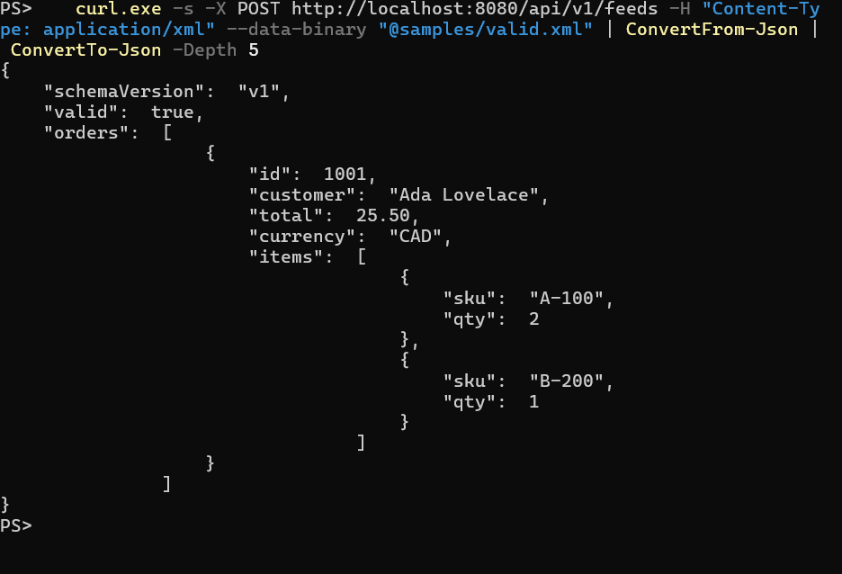
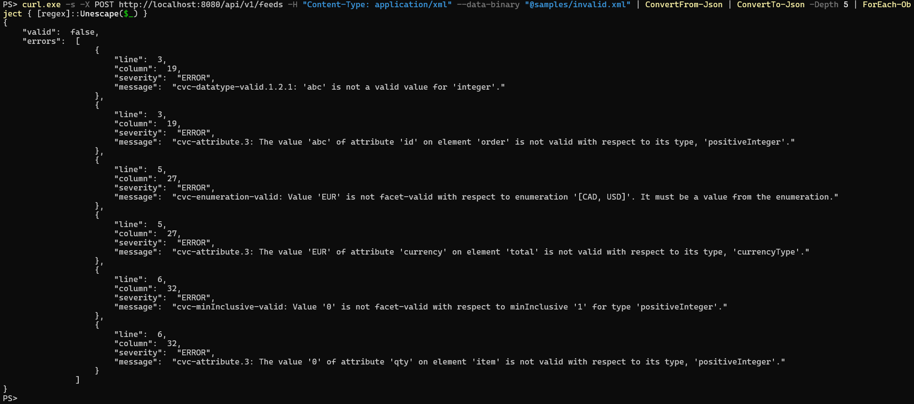

# Schema Sentinel


A Spring Boot gateway that validates incoming XML feeds against versioned XSD schemas, reports **every** error with line and column numbers, and converts valid feeds to JSON.

## The problem
Partners and legacy systems send XML that is often wrong: a missing field, a bad number, an invalid currency. Bad data that reaches downstream systems causes failed jobs and bugs. This service checks feeds at the front door and tells the sender exactly what to fix, all in one pass.

## Features
- Validates XML against **versioned XSDs** (`schemas/v1/`; add `v2/` with no code changes)
- Returns **all** errors at once, with line and column numbers
- Converts valid feeds to clean JSON
- **XXE protection** (DOCTYPE blocked, external entities disabled), covered by a test
- JUnit 5 and MockMvc tests, Dockerfile, GitHub Actions CI

## Tech stack
Java 21, Spring Boot 3.3, Maven, JUnit 5, Docker, GitHub Actions

## Quick start
Requires JDK 21 and Maven.

```bash
git clone https://github.com/YOUR-USERNAME/schema-sentinel.git
cd schema-sentinel
mvn verify            # runs the tests
mvn spring-boot:run   # starts on http://localhost:8080
```

## Demo

**Valid feed** (`samples/valid.xml`) is converted to JSON:



**Invalid feed** (`samples/invalid.xml`) returns HTTP 422 with every problem and its line number:



Try it yourself:
```bash
curl -X POST http://localhost:8080/api/v1/feeds -H "Content-Type: application/xml" --data-binary @samples/valid.xml
curl -X POST http://localhost:8080/api/v1/feeds -H "Content-Type: application/xml" --data-binary @samples/invalid.xml
```
On Windows PowerShell, use `curl.exe` instead of `curl`.

## API
| Method | Path | Result |
|---|---|---|
| POST | `/api/{version}/feeds` | 200 + JSON, or 422 + error list |
| POST | `/api/{version}/feeds/validate` | 200 if valid, 422 + error list otherwise |
| GET | `/actuator/health` | health check |

Unknown schema versions return 404.

## Project structure
```
src/main/java/dev/sentinel/
  api/          REST controller and error handling
  validation/   schema loading and XSD validation
  transform/    XML to Java objects (serialized to JSON)
src/main/resources/schemas/   versioned XSDs
src/test/                     tests
samples/                      example feeds
docs/                         demo screenshots
```

## Design decisions
- **Collect all errors, not just the first.** A custom `ErrorHandler` gathers every violation, so the sender fixes the feed in one pass.
- **Versioned schemas on the classpath.** A new version is a new folder, and schemas are cached after first load.
- **XXE hardening.** DOCTYPE is disabled and external DTD/schema access is blocked, with a test.
- **DOM instead of JAXB.** The feeds are small and already validated, so a simple mapper beats generated classes. For very large feeds I would switch to StAX streaming.

## Roadmap
- [ ] Async processing with RabbitMQ, a dead-letter queue, and a replay endpoint
- [ ] PostgreSQL persistence of feeds and results
- [ ] XSLT transforms per schema version
- [ ] Testcontainers integration tests and Micrometer dashboards
